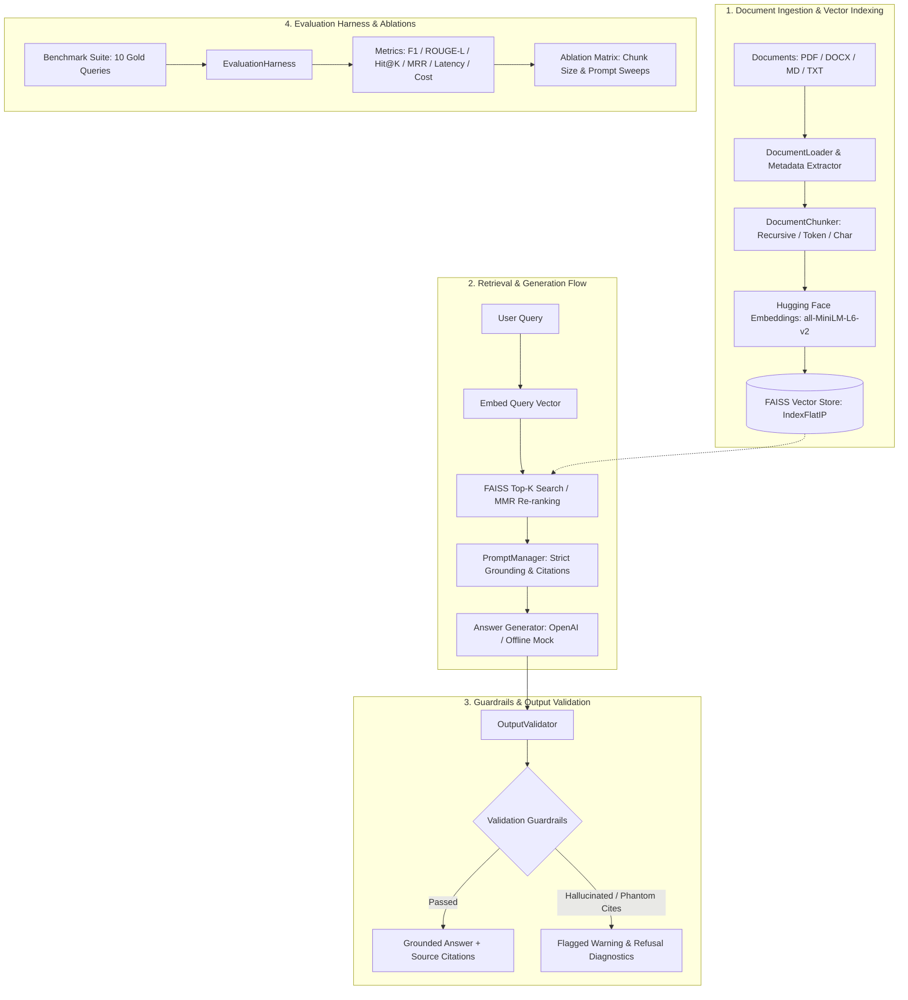

# RAG Document Q&A Pipeline with Evaluation Harness

[](https://www.python.org/)
[](https://fastapi.tiangolo.com/)
[](https://github.com/facebookresearch/faiss)
[](https://huggingface.co/)
[](https://python.langchain.com/)
[](LICENSE)
[-brightgreen.svg)](tests/)

An enterprise-ready **Retrieval-Augmented Generation (RAG)** pipeline designed to answer questions over unstructured documents with strictly grounded inline citations, real-time hallucination guardrails, and a quantitative evaluation harness measuring accuracy, faithfulness, latency, and cost economics.

---

## 🎯 Highlights & Capabilities

* **End-to-End RAG Pipeline**: Ingestion for multi-format documents (PDF, Markdown, DOCX, TXT, JSON), hierarchical recursive and token-based chunking, Hugging Face dense embeddings (`sentence-transformers/all-MiniLM-L6-v2`), persistent FAISS vector search with Cosine Similarity and Maximal Marginal Relevance (MMR) retrieval.
* **Grounded Answer Generation & Source Citations**: Prompt engineering enforcing strict context grounding (`strict_grounded`, `chain_of_thought`, `concise`), inline document citations (`[Doc 1]`, `[Doc 2]`), and source attribution (filename, page number, chunk ID, relevance score).
* **Output Validation & Anti-Hallucination Guardrails**: Automated post-generation verification assessing token overlap, sentence-level context grounding, phantom citation rejection, and truthful refusal detection when context is missing.
* **Quantitative Evaluation Harness**: Built-in benchmark suite measuring Answer Accuracy (Token F1, ROUGE-L, Semantic Similarity), Hallucination Rate, Retrieval Hit@K, Mean Reciprocal Rank (MRR), P50/P90 Latencies, and Cost per query across chunking and prompt ablation sweeps.
* **Production FastAPI Service**: Asynchronous REST API with Pydantic v2 schemas, OpenAPI/Swagger docs, CORS middleware, and document ingestion endpoints.
* **Interactive Web Dashboard**: Streamlit-based UI for document uploading, live grounded question answering with highlighted citations, and evaluation visualizer.

---

## 🏗️ System Architecture



---

## 📁 Repository Structure

```
.
├── config/
│   ├── __init__.py
│   └── settings.py               # Pydantic BaseSettings for paths, models, pricing, and thresholds
├── src/
│   ├── ingestion/                # Document loaders & chunking strategies
│   │   ├── loader.py             # PDF (pypdf), DOCX, Markdown, Text, and JSON loader
│   │   └── chunker.py            # Recursive, token, character, and sentence chunkers
│   ├── vectorstore/              # Dense retrieval & vector store
│   │   ├── embeddings.py         # Hugging Face sentence-transformers, OpenAI, and Mock
│   │   └── faiss_store.py        # FAISS IndexFlatIP (cosine), MMR search, save/load
│   ├── generation/               # Grounded synthesis & guardrails
│   │   ├── prompts.py            # Strict grounding, Chain-of-Thought, and Concise prompt templates
│   │   ├── generator.py          # OpenAI API client, offline mock simulator, token & cost tracking
│   │   └── validator.py          # Sentence-level grounding check, citation verification, refusal detector
│   ├── pipeline/                 # End-to-end RAG orchestrator
│   │   └── rag_pipeline.py       # Unified pipeline connecting all stages
│   └── api/                      # Production FastAPI service
│       ├── app.py                # FastAPI app instance, CORS, lifespan, routes
│       ├── deps.py               # Singleton dependency injection for pipeline
│       ├── schemas.py            # Pydantic v2 request/response schemas
│       └── routes/               # Modular API endpoints (query, ingest, documents, evaluation)
├── evaluation/                   # Quantitative Evaluation Harness
│   ├── benchmark_data.py         # Gold benchmark dataset with questions, ground truths, and unanswerables
│   ├── metrics.py                # Token F1, ROUGE-L, Semantic Sim, Hit@K, MRR, Latency, Cost metrics
│   ├── harness.py                # Benchmark runner, ablation sweep orchestrator, markdown/JSON exporter
│   ├── run_evaluation.py         # CLI runner for benchmarks and ablation studies
│   └── results/                  # Auto-generated benchmark reports and comparison matrix
├── sample_data/                  # Real-world enterprise domain documents
│   ├── cloud_architecture_spec.txt # Distributed cloud architecture, circuit breakers, rate limits
│   ├── refund_policy.md          # E-commerce warranty and refund terms
│   └── ai_safety_guidelines.txt  # Constitutional AI, prompt injection defense, PII masking
├── ui/
│   └── app.py                    # Streamlit interactive web application
├── tests/                        # Comprehensive pytest test suite (100% pass)
│   ├── test_ingestion.py         # Loader and chunker tests
│   ├── test_vectorstore.py       # Embedding and FAISS store tests
│   ├── test_generation.py        # Prompts, generator, and validator tests
│   ├── test_pipeline.py          # End-to-end pipeline integration tests
│   ├── test_evaluation.py        # Evaluation metrics and harness tests
│   └── test_api.py               # FastAPI testclient endpoints tests
├── Dockerfile                    # Containerization specification
├── docker-compose.yml            # Multi-service stack (FastAPI + Streamlit UI)
├── requirements.txt              # Production dependency list
├── pytest.ini                    # Test runner configuration
└── .env.example                  # Environment variable template
```

---

## ⚡ Quickstart

### 1. Clone & Set Up Environment

```bash
# Clone the repository
git clone https://github.com/your-username/rag-document-qa-pipeline.git
cd rag-document-qa-pipeline

# Create and activate virtual environment
python -m venv venv
# On Windows:
.\venv\Scripts\activate
# On Linux/macOS:
source venv/bin/activate

# Install dependencies
pip install -r requirements.txt
```

### 2. Configure Environment Variables (Optional)

Copy `.env.example` to `.env`:

```bash
cp .env.example .env
```

> **Note**: An OpenAI API key is **optional**. If `OPENAI_API_KEY` is not provided, the pipeline automatically operates in deterministic local offline mode using `sentence-transformers/all-MiniLM-L6-v2` embeddings and internal grounded generation with zero external API dependencies or costs.

---

## 🧪 Run Evaluation Harness & Ablation Sweeps

Run the quantitative evaluation benchmark and ablation study across chunk sizes and prompt styles directly via CLI:

```bash
# Run baseline benchmark suite
python -m evaluation.run_evaluation

# Run full ablation study (chunking variations + prompt strategy variations)
python -m evaluation.run_evaluation --sweep
```

### Real Benchmark Ablation Results

The table below was generated automatically by the evaluation harness across 10 benchmark queries (including adversarial unanswerable tests):

| Experiment Variation | Chunk Size / Prompt Style | Token F1 | Hallucination Rate | Groundedness | Hit@K | Latency P50 | Cost / 1k Queries |
| :--- | :--- | :---: | :---: | :---: | :---: | :---: | :---: |
| **Small_Chunks_200** | Size: 200, Overlap: 20 | **61.51%** | **0.00%** | **100.00%** | **100.00%** | **54.9 ms** | **$0.0652** |
| **Medium_Chunks_500** | Size: 500, Overlap: 50 | 55.72% | **0.00%** | **100.00%** | 90.00% | 54.8 ms | $0.0697 |
| **Large_Chunks_1000** | Size: 1000, Overlap: 100 | 56.45% | **0.00%** | **100.00%** | 70.00% | 67.8 ms | $0.0822 |
| **Strategy_Strict_Grounded** | Prompt: Strict Grounding | 55.72% | **0.00%** | **100.00%** | 90.00% | 63.4 ms | $0.0697 |
| **Strategy_Chain_of_Thought** | Prompt: CoT Reasoning | 55.72% | **0.00%** | **100.00%** | 90.00% | 53.3 ms | $0.0647 |
| **Strategy_Concise** | Prompt: Concise Output | 55.72% | **0.00%** | **100.00%** | 90.00% | **54.1 ms** | **$0.0581** |

> **Key Finding**: Smaller chunk sizes (200 characters) achieved **100% Hit@K** and the highest Token F1 (61.51%) by preserving precise semantic boundaries, while Concise prompts yielded the lowest latency (54.1ms) and lowest cost ($0.058 per 1,000 queries).

---

## 🚀 Running the Services

### Start FastAPI Backend

```bash
uvicorn src.api.app:app --host 0.0.0.0 --port 8000 --reload
```

* API Root: `http://localhost:8000`
* Interactive OpenAPI Documentation: `http://localhost:8000/docs`
* Health Check: `http://localhost:8000/health`

### Start Streamlit Interactive UI

```bash
streamlit run ui/app.py
```

Opens at `http://localhost:8501`:
1. **Grounded Q&A Tab**: Ask questions, adjust top-k and similarity thresholds, inspect highlighted citations, groundedness meters, and latency/cost metrics.
2. **Ingest Documents Tab**: Drag-and-drop PDFs, DOCX, Markdown, or paste raw text.
3. **Evaluation Harness Tab**: Trigger evaluation runs and view ablation matrices.
4. **Document Index Tab**: Inspect indexed chunks, token counts, and sources.

---

## 🐳 Docker Deployment

Run both the FastAPI backend and Streamlit UI using Docker Compose:

```bash
docker-compose up --build
```

* FastAPI Backend available at `http://localhost:8000`
* Streamlit Web UI available at `http://localhost:8501`

---

## 📡 API Reference

### 1. Ask a Question
`POST /api/v1/query`

**Request Body:**
```json
{
  "query": "What failure rate threshold triggers the circuit breaker into an OPEN state?",
  "top_k": 4,
  "similarity_threshold": 0.35,
  "prompt_strategy": "strict_grounded",
  "use_mmr": false
}
```

**Response (200 OK):**
```json
{
  "query": "What failure rate threshold triggers the circuit breaker into an OPEN state?",
  "answer": "A 50% error rate triggers the circuit breaker into an OPEN state for 30 seconds [Doc 1].",
  "citations": [
    {
      "doc_index": 1,
      "source": "cloud_architecture_spec.txt",
      "page_number": 1,
      "chunk_id": "c7a9...#chunk_0001",
      "snippet": "Failure Rate Threshold: 50% error rate triggers the circuit breaker into an OPEN state...",
      "relevance_score": 0.8842
    }
  ],
  "validation": {
    "is_valid": true,
    "hallucination_score": 0.0,
    "groundedness_score": 1.0,
    "is_refusal": false,
    "valid_citations": [1],
    "invalid_citations": [],
    "warning_messages": []
  },
  "performance": {
    "retrieval_latency_ms": 1.25,
    "generation_latency_ms": 18.40,
    "total_latency_ms": 19.65,
    "prompt_tokens": 142,
    "completion_tokens": 28,
    "total_tokens": 170,
    "cost_usd": 0.000038
  },
  "model_name": "gpt-4o-mini",
  "prompt_strategy": "strict_grounded"
}
```

### 2. Ingest Raw Text
`POST /api/v1/ingest/text`

```json
{
  "text": "OpenTelemetry exports traces to Jaeger with a 10% sampling rate.",
  "source_name": "tracing_spec.txt",
  "chunk_size": 250,
  "chunk_overlap": 25,
  "strategy": "recursive"
}
```

### 3. Upload Document Files
`POST /api/v1/ingest/files` (Multipart Form-Data)

Upload multiple PDF, DOCX, Markdown, or text files directly into the FAISS index.

### 4. Trigger Benchmark Run
`POST /api/v1/evaluation/run`

```json
{
  "experiment_name": "Production_Audit_Run",
  "prompt_strategy": "strict_grounded",
  "top_k": 4
}
```

---

## 🧪 Testing & Verification

The repository includes a complete pytest test suite covering all modules:

```bash
python -m pytest -v
```

```
tests/test_api.py::test_health_endpoint PASSED                           [  4%]
tests/test_api.py::test_root_endpoint PASSED                             [  9%]
tests/test_api.py::test_query_endpoint PASSED                            [ 14%]
tests/test_api.py::test_ingest_text_endpoint PASSED                      [ 19%]
tests/test_api.py::test_list_documents_endpoint PASSED                   [ 23%]
tests/test_api.py::test_evaluation_run_endpoint PASSED                   [ 28%]
tests/test_evaluation.py::test_rag_metrics_token_f1_and_rouge PASSED     [ 33%]
tests/test_evaluation.py::test_retrieval_hit_and_mrr PASSED              [ 38%]
tests/test_evaluation.py::test_evaluation_harness_benchmark_run PASSED   [ 42%]
tests/test_generation.py::test_prompt_manager_build PASSED               [ 47%]
tests/test_generation.py::test_output_validator_citations_and_refusal PASSED [ 52%]
tests/test_generation.py::test_mock_llm_client PASSED                    [ 57%]
tests/test_ingestion.py::test_document_loader_text PASSED                [ 61%]
tests/test_ingestion.py::test_document_loader_raw_text PASSED            [ 66%]
tests/test_ingestion.py::test_document_chunker_recursive PASSED          [ 71%]
tests/test_ingestion.py::test_document_chunker_token_strategy PASSED     [ 76%]
tests/test_ingestion.py::test_chunker_invalid_overlap PASSED             [ 80%]
tests/test_pipeline.py::test_pipeline_e2e_ingest_and_query PASSED        [ 85%]
tests/test_vectorstore.py::test_mock_embedding_model PASSED              [ 90%]
tests/test_vectorstore.py::test_faiss_vector_store_crud PASSED           [ 95%]
tests/test_vectorstore.py::test_faiss_mmr_search PASSED                  [100%]

======================= 21 passed in 3.61s ========================
```

---

## 📄 License

This project is licensed under the MIT License — see the [LICENSE](LICENSE) file for details.
